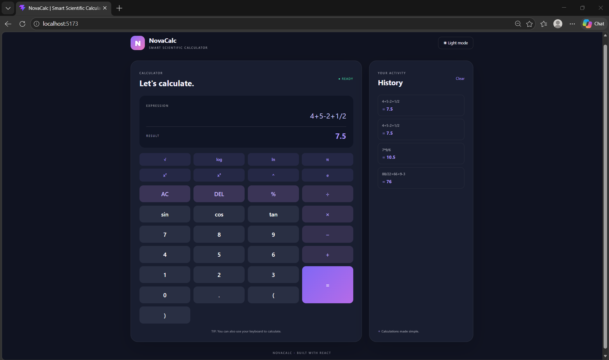

# Ex04 Simple Calculator - React Project
## Date:23-11-2026
## Name : Dhanashree A
## Reg No : 212224040065

## AIM
To  develop a Simple Calculator using React.js with clean and responsive design, ensuring a smooth user experience across different screen sizes.

## ALGORITHM
### STEP 1
Create a React App.

### STEP 2
Open a terminal and run:
  <ul><li>npx create-react-app simple-calculator</li>
  <li>cd simple-calculator</li>
  <li>npm start</li></ul>

### STEP 3
Inside the src/ folder, create a new file Calculator.js and define the basic structure.

### STEP 4
Plan the UI: Display screen, number buttons (0-9), operators (+, -, *, /), clear (C), and equal (=).

### STEP 5
Create a new file Calculator.css in src/ and add the styling.

### STEP 6
Open src/App.js and modify it.

### STEP 7
Start the development server.
  npm start

### STEP 8
Open http://localhost:3000/ in the browser.

### STEP 9
Test the calculator by entering numbers and operations.

### STEP 10
Fix styling issues and refine content placement.

### STEP 11
Deploy the website.

### STEP 12
Upload to GitHub Pages for free hosting.

## PROGRAM

### App.jsx


```
import { useState } from 'react'
import heroImg from './assets/hero.png'
import reactLogo from './assets/react.svg'
import viteLogo from './assets/vite.svg'
import './App.css'

function App() {
  const [count, setCount] = useState(0)

  return (
    <>
      <section id="center">
        <div className="hero">
          
          
          
        </div>
        <div>
          <h1>Get started</h1>
          <p>
            Edit <code>src/App.jsx</code> and save to test <code>HMR</code>
          </p>
        </div>
        <button
          type="button"
          className="counter"
          onClick={() => setCount((count) => count + 1)}
        >
          Count is {count}
        </button>
      </section>

      <div className="ticks"></div>

      <section id="next-steps">
        <div id="docs">
          <svg className="icon" role="presentation" aria-hidden="true">
            <use href="/icons.svg#documentation-icon"></use>
          </svg>
          <h2>Documentation</h2>
          <p>Your questions, answered</p>
          <ul>
            <li>
              <a href="https://vite.dev/" target="_blank">
                
                Explore Vite
              </a>
            </li>
            <li>
              <a href="https://react.dev/" target="_blank">
                
                Learn more
              </a>
            </li>
          </ul>
        </div>
        <div id="social">
          <svg className="icon" role="presentation" aria-hidden="true">
            <use href="/icons.svg#social-icon"></use>
          </svg>
          <h2>Connect with us</h2>
          <p>Join the Vite community</p>
          <ul>
            <li>
              <a href="https://github.com/vitejs/vite" target="_blank">
                <svg
                  className="button-icon"
                  role="presentation"
                  aria-hidden="true"
                >
                  <use href="/icons.svg#github-icon"></use>
                </svg>
                GitHub
              </a>
            </li>
            <li>
              <a href="https://chat.vite.dev/" target="_blank">
                <svg
                  className="button-icon"
                  role="presentation"
                  aria-hidden="true"
                >
                  <use href="/icons.svg#discord-icon"></use>
                </svg>
                Discord
              </a>
            </li>
            <li>
              <a href="https://x.com/vite_js" target="_blank">
                <svg
                  className="button-icon"
                  role="presentation"
                  aria-hidden="true"
                >
                  <use href="/icons.svg#x-icon"></use>
                </svg>
                X.com
              </a>
            </li>
            <li>
              <a href="https://bsky.app/profile/vite.dev" target="_blank">
                <svg
                  className="button-icon"
                  role="presentation"
                  aria-hidden="true"
                >
                  <use href="/icons.svg#bluesky-icon"></use>
                </svg>
                Bluesky
              </a>
            </li>
          </ul>
        </div>
      </section>

      <div className="ticks"></div>
      <section id="spacer"></section>
    </>
  )
}

export default App


```


### index.css

```

html {
  min-width: 320px;
  min-height: 100%;
}

body {
  margin: 0;
  min-width: 320px;
  min-height: 100vh;
}

button {
  font-family: inherit;
}


```

### App.js

```
import Calculator from "./Calculator";

function App() {
  return (
    <div>
      <Calculator />
    </div>
  );
}

export default App;

```


## OUTPUT



## RESULT
The program for developing a simple calculator in React.js is executed successfully.
